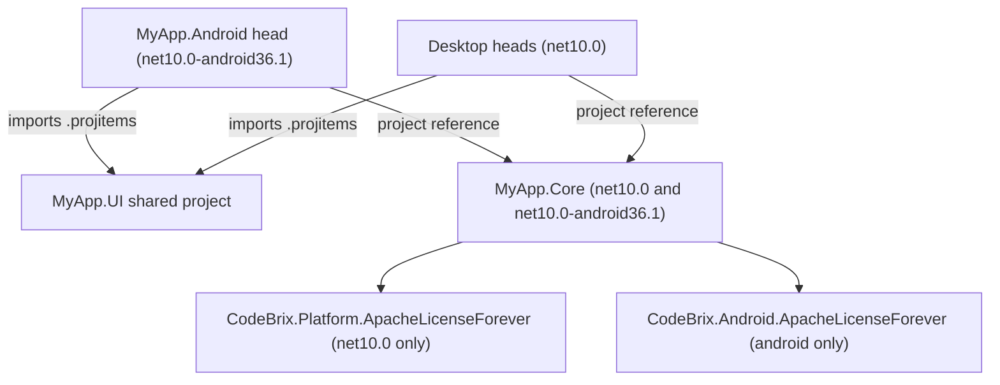

<sub>[CodeBrix](../../README.md) › [Build a CodeBrix.Platform application](README.md) › Android and Googlebooks</sub>

# Android and Googlebooks

**By the end of this chapter you will be able to take an existing CodeBrix.Platform application - its `.Core` library, its `.UI` XAML and its view models - and ship it as a native Android application that treats the desktop as a first-class form factor.** CodeBrix.Android is the library family that does it. The pages, view models and code-behind you already have compile unchanged for Android; you add one head project with two small classes, give `.Core` a second target framework, and swap each add-in package for its Android twin.

CodeBrix.Android is desktop-first. It targets Android desktops - Googlebooks, the Android laptops Google and its partners have unveiled, and phones docked in desktop mode - and treats Android tablets and phones as first-class targets too, adapting each page to the window it runs in. A Googlebook runs a CodeBrix.Platform application through CodeBrix.Android.

## What CodeBrix.Android is

CodeBrix.Android builds CodeBrix.Platform applications as native Android applications. It is not a seventh Skia head: on Android every element is shown with a real Android or Material Components view rather than drawn by CodeBrix. What stays the same is everything above the pixels - the object model, dependency properties, bindings, resources, styles, templates, `Frame` and `Page`, and the same layout engine as on the desktop, which decides where each native view goes.

| | |
| --- | --- |
| **Repository** | [ellisnet/CodeBrix.Android](https://github.com/ellisnet/CodeBrix.Android) |
| **Framework package** | [`CodeBrix.Android.ApacheLicenseForever`](https://www.nuget.org/packages/CodeBrix.Android.ApacheLicenseForever) |
| **Add-in packages** | One per CodeBrix.Platform add-in, `CodeBrix.Android.<AddIn>.ApacheLicenseForever` - see [Add-ins on Android](#add-ins-on-android) |
| **Target framework** | `net10.0-android36.1` |
| **Minimum Android version** | Android 13 (API level 33) |
| **License** | Apache 2.0, every package |
| **API guide** | [AGENT-README.txt](https://github.com/ellisnet/CodeBrix.Android/blob/main/AGENT-README.txt) - the authoritative reference, shipped inside the package too |
| **Library page** | [CodeBrix.Android](../libraries/CodeBrix.Android.md) |

The framework package carries everything an Android head needs: the platform-neutral CodeBrix.Platform assemblies (the same object model as on the desktop), the CodeBrix.Android assemblies that implement them on Android, the build logic that compiles CodeBrix.Platform XAML for Android, and the CBAND analyzer. It depends on the .NET bindings of Material Components for Android and AndroidX, `Microsoft.Extensions.Logging`, `Microsoft.Extensions.DependencyInjection.Abstractions`, `Microsoft.Extensions.Hosting.Abstractions`, `CodeBrix.ServiceLocator` and the CodeBrix Fluent symbols font package. An Android head never references the CodeBrix.Platform desktop packages.

Package ID and namespaces differ, as everywhere in the family:

- NuGet package ID: `CodeBrix.Android.ApacheLicenseForever`
- Assemblies and namespaces used by the head project: `CodeBrix.Android.UI.Hosting` (`CodeBrixApplication`, `CodeBrixActivity`, `SoftInputAdjust`), `CodeBrix.Android.UI.Logging` (`LogcatLoggerProvider`) and `CodeBrix.Android.UI.Diagnostics` (`VisualTreeDump`)
- Application code and XAML keep the CodeBrix.Platform namespaces - `Microsoft.UI.Xaml`, `Microsoft.UI.Xaml.Controls`, `CodeBrix.Platform.UI` and the rest

## What compiles unchanged

CodeBrix.Android's rule is "paste always": a CodeBrix.Platform page and its code-behind compile for Android as they are, with the same XAML dialect as a desktop build.

- **XAML.** The CodeBrix.Platform XAML source generator runs on every `Page` item, `App.xaml` included. The conditional XAML namespaces a desktop build includes (`not_android`, `skia`, `netstdref`, ...) are included, the ones it excludes (`android`, `not_skia`, ...) are excluded, and `d:` design-time attributes are ignored exactly as on the desktop.
- **The application.** `App.xaml.cs` runs unchanged: the `App` constructor, `OnLaunched`, the `Window`, the `Frame` and `Frame.Navigate`.
- **View models and services.** Anything in `.Core` compiles for the Android target framework alongside the desktop one.
- **String resources.** `.resw` files become embedded resources, as on the desktop.
- **Assets.** `ms-appx:///` URIs resolve to the application's assets and to the assets of referenced CodeBrix packages, fonts included.
- **Add-ins.** Code and XAML written against an add-in compile and run unchanged once the add-in's Android package replaces its CodeBrix.Platform package.

Code that genuinely has to differ on Android uses the compile constants the package defines:

```csharp
#if HAS_CODEBRIX_ANDROID
    // Android-only code
#endif
```

The package defines `HAS_CODEBRIX`, `__CODEBRIX__`, `HAS_CODEBRIX_WINUI`, `__CODEBRIX_WINUI__`, `WINUI_WINDOWING`, `CODEBRIX_HAS_FRAMEWORKELEMENT_MEASUREOVERRIDE`, `CODEBRIX_HAS_NO_IDEPENDENCYOBJECT`, `CODEBRIX_REFERENCE_API`, `HAS_CODEBRIX_ANDROID` and `__CODEBRIX_ANDROID__`. It does NOT define `HAS_CODEBRIX_SKIA`, `__CODEBRIX_SKIA__` or `__DESKTOP__`, so code guarded by those is left out of the Android build.

## Adding an Android head to an existing application

The application shape is the one [04 - Project architecture](04-project-architecture.md) describes - `MyApp.Core`, the `MyApp.UI` shared project, and one head project per platform. Android adds one more head and changes one thing in `.Core`.



The whole change, in one list:

1. **`.Core` gets a second target framework**, `net10.0-android36.1`, and the CodeBrix.Platform framework package moves into a `net10.0`-only `ItemGroup`, with `CodeBrix.Android.ApacheLicenseForever` in an Android-only one.
2. **Each add-in package is split the same way**: the `CodeBrix.Platform.<AddIn>` package in the `net10.0` group, the `CodeBrix.Android.<AddIn>.ApacheLicenseForever` package in the Android group.
3. **A head project, `MyApp.Android`**, imports the `.UI` `.projitems`, references `.Core`, and references `CodeBrix.Android.ApacheLicenseForever`.
4. **Two classes in the head**, `MainApplication` and `MainActivity`, take the place of a desktop head's `Program.cs`.

Nothing in `.UI` changes, and no view model changes.

### The .Core project

This is the `.Core` project the CodeBrix.Android repository's application template uses when Android is one of the heads:

```xml
<Project Sdk="Microsoft.NET.Sdk">
  <PropertyGroup>
    <!-- net10.0 for the desktop heads, net10.0-android36.1 for the Android head -->
    <TargetFrameworks>net10.0;net10.0-android36.1</TargetFrameworks>

    <!-- Match the namespace used by the app code -->
    <RootNamespace>MyApp</RootNamespace>
  </PropertyGroup>

  <PropertyGroup Condition="'$(TargetFramework)' == 'net10.0-android36.1'">
    <SupportedOSPlatformVersion>33</SupportedOSPlatformVersion>
  </PropertyGroup>

  <ItemGroup>
    <PackageReference Include="Microsoft.Extensions.Hosting" />
    <PackageReference Include="Microsoft.Extensions.Logging.Console" />
    <PackageReference Include="CodeBrix.Platform.Fonts.OpenSans.ApacheLicenseForever" />
  </ItemGroup>

  <!-- The CodeBrix.Platform desktop package for the desktop heads only: it must never reach the Android app -->
  <ItemGroup Condition="'$(TargetFramework)' == 'net10.0'">
    <PackageReference Include="CodeBrix.Platform.ApacheLicenseForever" />
  </ItemGroup>

  <!-- CodeBrix.Android for the Android head -->
  <ItemGroup Condition="'$(TargetFramework)' == 'net10.0-android36.1'">
    <PackageReference Include="CodeBrix.Android.ApacheLicenseForever" />
  </ItemGroup>
</Project>
```

Packages that are not UI packages - the generic host, logging, the bundled font, your own libraries - stay in the unconditional `ItemGroup` and reach both targets. The font package in particular flows to the Android application this way and is packed as assets; nothing else is needed for fonts.

If your `.Core` declares `HAS_CODEBRIX;HAS_CODEBRIX_WINUI` in `DefineConstants`, as [03 - Your first application](03-your-first-application.md) does, keep it for the `net10.0` target. The HelloPaste sample puts it in a `net10.0`-only `PropertyGroup`, because the Android target gets those constants from CodeBrix.Android:

```xml
<PropertyGroup Condition="'$(TargetFramework)' == 'net10.0'">
  <!-- CodeBrix.Platform needs this define for its internal conditional compilation (the Android flavor gets it from CodeBrix.Android) -->
  <DefineConstants>$(DefineConstants);HAS_CODEBRIX;HAS_CODEBRIX_WINUI</DefineConstants>
</PropertyGroup>
```

> [!IMPORTANT]
> A two-target `.Core` needs the .NET "android" workload on every machine that builds the solution; without it the build stops with NETSDK1147. Add the second target framework only when the application really ships an Android head.

### The head project

`src/MyApp.Android/MyApp.Android.csproj`, from the template:

```xml
<Project Sdk="Microsoft.NET.Sdk">
  <PropertyGroup>
    <TargetFramework>net10.0-android36.1</TargetFramework>
    <SupportedOSPlatformVersion>33</SupportedOSPlatformVersion>
    <OutputType>Exe</OutputType>

    <!-- The Android package name and the name under the launcher icon -->
    <ApplicationId>com.companyname.MyApp</ApplicationId>
    <ApplicationTitle>MyApp</ApplicationTitle>
    <ApplicationVersion>1</ApplicationVersion>
    <ApplicationDisplayVersion>1.0</ApplicationDisplayVersion>
  </PropertyGroup>

  <!-- Release builds are trimmed; an .apk can be installed directly (the default, .aab, is for app stores) -->
  <PropertyGroup Condition="'$(Configuration)' == 'Release'">
    <AndroidPackageFormat>apk</AndroidPackageFormat>
  </PropertyGroup>

  <!-- Tell MSBuild to treat .xaml files as CodeBrix.Platform XAML pages -->
  <ItemGroup>
    <Page Include="**\*.xaml" Exclude="bin\**\*.xaml;obj\**\*.xaml" />
    <None Remove="**\*.xaml" />
  </ItemGroup>

  <!-- Shared UI files (App.xaml + Views) -->
  <Import Project="..\MyApp.UI\MyApp.UI.projitems" Label="Shared" />
  <ItemGroup>
    <ProjectReference Include="..\MyApp.Core\MyApp.Core.csproj" />
  </ItemGroup>

  <!-- EXACTLY ONE platform head package; all other packages come from MyApp.Core -->
  <ItemGroup>
    <PackageReference Include="CodeBrix.Android.ApacheLicenseForever" />
  </ItemGroup>
</Project>
```

The `ApplicationId` is the application's identity on a device and in a store. Replace `com.companyname` with your organization's own prefix, and keep every dot-separated segment starting with a letter and clear of Java keywords (`int`, `new`, `package`, ...).

Like every other head, the Android head does NOT set `<RootNamespace>`: sharing the `.Core` root namespace makes the XAML source generator emit a colliding `GlobalStaticResources` type. Its default root namespace is therefore `MyApp.Android`, which is why the two classes below reach Mono.Android types through `using Android.*;` directives, never through a bare `Android.` prefix.

### The two classes

The Android head has no `Program.cs`. Android starts the application through an `Application` class and a launcher activity, and those are the only two files the head adds. `MainApplication.cs`:

```csharp
using Android.App;
using Android.Runtime;
using CodeBrix.Android.UI.Hosting;
using System;

namespace MyApp;

/// <summary>
/// The Android application. CodeBrixApplication sets up logging (logcat) and the Android
/// implementation of CodeBrix.Platform; the first activity then starts the shared App
/// (App.xaml.cs runs unchanged: OnLaunched, Window, Frame navigation).
/// </summary>
[Application]
public class MainApplication : CodeBrixApplication
{
    public MainApplication(IntPtr handle, JniHandleOwnership transfer)
        : base(handle, transfer)
    {
        //The soft keyboard pans the window by default (SoftInputAdjust.Pan); to lay the page out again above it instead:
        //SoftInputAdjust = SoftInputAdjust.Resize;
    }

    protected override Microsoft.UI.Xaml.Application CreateApp() => new App();
}
```

`MainActivity.cs`:

```csharp
using Android.App;
using CodeBrix.Android.UI.Hosting;

namespace MyApp;

/// <summary>
/// The launcher activity that shows the app's XAML window. HandledConfigurationChanges keeps the
/// activity alive when the window is resized, docked, rotated or switched to dark mode.
/// </summary>
[Activity(
    Label = "MyApp",
    MainLauncher = true,
    Theme = "@style/Theme.Material3.DayNight.NoActionBar",
    ConfigurationChanges = CodeBrixActivity.HandledConfigurationChanges)]
public class MainActivity : CodeBrixActivity
{
}
```

And `AndroidManifest.xml`, which needs no permissions for a plain application:

```xml
<?xml version="1.0" encoding="utf-8"?>
<manifest xmlns:android="http://schemas.android.com/apk/res/android">
  <application android:allowBackup="true" android:label="MyApp" android:supportsRtl="true"></application>
</manifest>
```

Three details in those files are load-bearing.

- **`CodeBrixApplication.OnCreate` runs first.** It configures logging and registers the Android implementation of every CodeBrix.Platform platform contract before any XAML type is used. The first `CodeBrixActivity` then starts the XAML application: `Application.Start`, the `App` constructor, `OnLaunched`. Your `App.InitializeLogging()` is only called by the desktop heads' `Program.Main`; on Android, `CodeBrixApplication` sets up logging itself.
- **The activity theme must be a Material Components theme** (`Theme.Material3.*`). `CodeBrixActivity` is an `AppCompatActivity`.
- **`ConfigurationChanges = CodeBrixActivity.HandledConfigurationChanges` is required.** Resizing, docking, orientation, density and night-mode changes must not re-create the activity - that is what lets a phone dock to a desktop and keep its state. Android reads the value from the manifest, so it cannot be inherited from the base class; every launcher activity states it.

The application has one XAML `Window`. If Android does re-create the activity, the same `Window` and its `Frame` content are shown again.

### The package and namespace changes, side by side

| Where | Desktop heads | Android head |
| --- | --- | --- |
| Head project target framework | `net10.0` (`net10.0-windows` for WPF) | `net10.0-android36.1`, `SupportedOSPlatformVersion` 33, an `ApplicationId` |
| Head package | One `CodeBrix.Platform.Runtime.Skia.*.ApacheLicenseForever` | `CodeBrix.Android.ApacheLicenseForever` |
| Startup code | `Program.cs` with `CodeBrixPlatformHostBuilder` and `.Use...()` | `MainApplication : CodeBrixApplication` and `MainActivity : CodeBrixActivity` |
| Head namespaces | `CodeBrix.Platform.UI.Hosting` | `CodeBrix.Android.UI.Hosting` |
| `.Core` framework package | `CodeBrix.Platform.ApacheLicenseForever` | `CodeBrix.Android.ApacheLicenseForever`, in the `net10.0-android36.1` group |
| `.Core` add-in packages | `CodeBrix.Platform.<AddIn>.<License>LicenseForever` | `CodeBrix.Android.<AddIn>.ApacheLicenseForever`, in the `net10.0-android36.1` group |
| Application, page and view-model namespaces | `Microsoft.UI.Xaml.*`, `CodeBrix.Platform.*` | Unchanged |

## Add-ins on Android

Every CodeBrix.Platform add-in has an Android package of its own, named after the add-in's CodeBrix.Platform package. Each one holds the add-in's platform-neutral assembly and its Android implementation, depends on the framework package and on the add-in packages it builds on, and runs the application's code and XAML for that add-in unchanged. The list is complete: an add-in that is not in it has no Android package.

| CodeBrix.Platform add-in | CodeBrix.Platform package (desktop) | CodeBrix.Android package | Brings with it |
| --- | --- | --- | --- |
| [AdvancedTextEdit](add-ins/AdvancedTextEdit.md) | `CodeBrix.Platform.AdvancedTextEdit.ApacheLicenseForever` | [`CodeBrix.Android.AdvancedTextEdit.ApacheLicenseForever`](https://www.nuget.org/packages/CodeBrix.Android.AdvancedTextEdit.ApacheLicenseForever) | TextLayout, SkiaSharp.Views |
| [AppSettings](add-ins/AppSettings.md) | `CodeBrix.Platform.AppSettings.ApacheLicenseForever` | [`CodeBrix.Android.AppSettings.ApacheLicenseForever`](https://www.nuget.org/packages/CodeBrix.Android.AppSettings.ApacheLicenseForever) | |
| [AudioPlayer](add-ins/AudioPlayer.md) | `CodeBrix.Platform.AudioPlayer.ApacheLicenseForever` | [`CodeBrix.Android.AudioPlayer.ApacheLicenseForever`](https://www.nuget.org/packages/CodeBrix.Android.AudioPlayer.ApacheLicenseForever) | [CodeBrix.Audio.Android](../libraries/CodeBrix.Audio.Android.md), CodeBrix.Audio's Android backend |
| [CommandBar](add-ins/CommandBar.md) | `CodeBrix.Platform.CommandBar.ApacheLicenseForever` | [`CodeBrix.Android.CommandBar.ApacheLicenseForever`](https://www.nuget.org/packages/CodeBrix.Android.CommandBar.ApacheLicenseForever) | Svg, SkiaSharp.Views |
| [FlexPanel](add-ins/FlexPanel.md) | `CodeBrix.Platform.FlexPanel.ApacheLicenseForever` | [`CodeBrix.Android.FlexPanel.ApacheLicenseForever`](https://www.nuget.org/packages/CodeBrix.Android.FlexPanel.ApacheLicenseForever) | |
| [Graphics2DSK](add-ins/Graphics2DSK.md) | `CodeBrix.Platform.Graphics2DSK.ApacheLicenseForever` | [`CodeBrix.Android.Graphics2DSK.ApacheLicenseForever`](https://www.nuget.org/packages/CodeBrix.Android.Graphics2DSK.ApacheLicenseForever) | SkiaSharp.Views |
| [Graphics3DGL](add-ins/Graphics3DGL.md) | `CodeBrix.Platform.Graphics3DGL.ApacheLicenseForever` | [`CodeBrix.Android.Graphics3DGL.ApacheLicenseForever`](https://www.nuget.org/packages/CodeBrix.Android.Graphics3DGL.ApacheLicenseForever) | |
| [Lottie](add-ins/Lottie.md) | `CodeBrix.Platform.Lottie.ApacheLicenseForever` | [`CodeBrix.Android.Lottie.ApacheLicenseForever`](https://www.nuget.org/packages/CodeBrix.Android.Lottie.ApacheLicenseForever) | SkiaSharp.Views |
| [MediaPlayer](add-ins/MediaPlayer.md) | `CodeBrix.Platform.MediaPlayer.LgplLicenseForever` | [`CodeBrix.Android.MediaPlayer.ApacheLicenseForever`](https://www.nuget.org/packages/CodeBrix.Android.MediaPlayer.ApacheLicenseForever) | |
| [PlotterView](add-ins/PlotterView.md) | `CodeBrix.Platform.PlotterView.ApacheLicenseForever` | [`CodeBrix.Android.PlotterView.ApacheLicenseForever`](https://www.nuget.org/packages/CodeBrix.Android.PlotterView.ApacheLicenseForever) | TextLayout, SkiaSharp.Views, CodeBrix.Plotter |
| [SkiaSharp views](add-ins/SkiaSharpViews.md) | `CodeBrix.Platform.SkiaSharp.Views.MitLicenseForever` | [`CodeBrix.Android.SkiaSharp.Views.ApacheLicenseForever`](https://www.nuget.org/packages/CodeBrix.Android.SkiaSharp.Views.ApacheLicenseForever) | |
| [Svg](add-ins/Svg.md) | `CodeBrix.Platform.Svg.ApacheLicenseForever` | [`CodeBrix.Android.Svg.ApacheLicenseForever`](https://www.nuget.org/packages/CodeBrix.Android.Svg.ApacheLicenseForever) | SkiaSharp.Views |
| [TerminalView](add-ins/TerminalView.md) | `CodeBrix.Platform.TerminalView.ApacheLicenseForever` | [`CodeBrix.Android.TerminalView.ApacheLicenseForever`](https://www.nuget.org/packages/CodeBrix.Android.TerminalView.ApacheLicenseForever) | TextLayout, SkiaSharp.Views |
| [TextLayout](add-ins/TextLayout.md) | `CodeBrix.Platform.TextLayout.ApacheLicenseForever` | [`CodeBrix.Android.TextLayout.ApacheLicenseForever`](https://www.nuget.org/packages/CodeBrix.Android.TextLayout.ApacheLicenseForever) | |
| [VideoPlayer](add-ins/VideoPlayer.md) | `CodeBrix.Platform.VideoPlayer.ApacheLicenseForever` | [`CodeBrix.Android.VideoPlayer.ApacheLicenseForever`](https://www.nuget.org/packages/CodeBrix.Android.VideoPlayer.ApacheLicenseForever) | SkiaSharp.Views, Graphics3DGL, CodeBrix.VideoPlayback, [CodeBrix.Audio.Android](../libraries/CodeBrix.Audio.Android.md) |
| [WebView](add-ins/WebView.md) | `CodeBrix.Platform.WebView.ApacheLicenseForever` | [`CodeBrix.Android.WebView.ApacheLicenseForever`](https://www.nuget.org/packages/CodeBrix.Android.WebView.ApacheLicenseForever) | |

The naming rule is mechanical: drop `CodeBrix.Platform.` and the license suffix from the desktop package, and wrap what is left as `CodeBrix.Android.<name>.ApacheLicenseForever`. Two Android packages carry a different license from their desktop counterparts, and the IDs say so: the Android SkiaSharp.Views package is Apache 2.0 where the desktop one is MIT, and the Android MediaPlayer package is Apache 2.0 because it plays through Media3 ExoPlayer rather than LibVLC.

The TriPaneView of CodeBrix.Platform's toolkit is part of the framework package itself and needs no add-in.

Every CodeBrix.Android package of one release depends on the others of the same release at exactly that version, so keep them all on one version.

Here is a `.Core` with two add-ins, each split by target framework:

```xml
<ItemGroup Condition="'$(TargetFramework)' == 'net10.0'">
  <PackageReference Include="CodeBrix.Platform.ApacheLicenseForever" />
  <PackageReference Include="CodeBrix.Platform.AppSettings.ApacheLicenseForever" />
  <PackageReference Include="CodeBrix.Platform.Lottie.ApacheLicenseForever" />
</ItemGroup>

<ItemGroup Condition="'$(TargetFramework)' == 'net10.0-android36.1'">
  <PackageReference Include="CodeBrix.Android.ApacheLicenseForever" />
  <PackageReference Include="CodeBrix.Android.AppSettings.ApacheLicenseForever" />
  <PackageReference Include="CodeBrix.Android.Lottie.ApacheLicenseForever" />
</ItemGroup>
```

An Android add-in package may also go straight into the Android head instead; what must never happen is a CodeBrix.Platform add-in package reaching the Android target.

What differs per add-in on Android, in short:

- **Drawing add-ins** - Svg, Graphics2DSK, Lottie, SkiaSharp.Views, TerminalView, AdvancedTextEdit, PlotterView - draw on a native Skia view. `SKCanvasElement.RenderOverride` runs on each draw, one canvas unit per DIP. `SKXamlCanvas` paints in software into a kept buffer and repaints on `Invalidate()`; `SKSwapChainPanel` is not supported.
- **Graphics3DGL** renders on an OpenGL ES 3.0 context, so shaders must be GLSL ES (`#version 300 es` plus a precision statement); desktop GLSL (`#version 330 core`) does not compile.
- **WebView and MediaPlayer** need the `INTERNET` permission in `AndroidManifest.xml` for http(s) pages and clips. WebView uses the device's system WebView; MediaPlayer uses Media3 ExoPlayer.
- **AudioPlayer and VideoPlayer** play through [CodeBrix.Audio.Android](../libraries/CodeBrix.Audio.Android.md), which the add-in initializes at start-up. Do not reference the desktop `CodeBrix.Audio.MitLicenseForever` package from the Android head. Codec add-ons such as Opus and AV1 are referenced and registered exactly as on the desktop.
- **AppSettings** keeps its database under the application's private files folder; backups, quarantine, export and import behave as on the desktop.
- **TerminalView and AdvancedTextEdit** open the soft keyboard when a finger or pen presses them - a terminal layout for the terminal, a word-composing text-editor keyboard for the editor.
- **PlotterView** uses the chart engine's default touch binding: one finger pans, two fingers pinch-zoom, a held finger shows the tracker.

[AGENT-README.txt](https://github.com/ellisnet/CodeBrix.Android/blob/main/AGENT-README.txt) (ADD-INS ON ANDROID) has the full per-add-in notes.

## Games

There is no Android package for the [CodeBrix.Platform.GameEngine](../libraries/CodeBrix.Platform.GameEngine.md) add-in: the GameEngine canvas is one of the things CodeBrix.Android states it does not support, alongside camera capture and TkCanvas. A game whose main page hosts the GameEngine canvas therefore does not get an Android head.

What a game can use on Android is the set of drawing and sound add-ins that do have Android packages: Graphics2DSK's `SKCanvasElement` and SkiaSharp.Views' `SKXamlCanvas` for 2D, Graphics3DGL's `GLCanvasElement` on OpenGL ES 3.0 for 3D, Lottie for animation, and AudioPlayer's `AudioPlayer`, `SoundEffect` and `MidiPlayer` for sound and music. `CompositionTarget.Rendering` is raised once per display frame for as long as something subscribes to it, so per-frame code drives a canvas the same way it does on the desktop, and an idle application costs no frames. Input arrives through the same routed events: touch, mouse, stylus and hardware keys reach `PointerPressed`, `KeyDown` and keyboard accelerators.

## Adaptive layout by window size class

CodeBrix.Android reads the window's width size class - compact, medium or expanded - and adapts the controls that have a natural Android form, live, while the application runs. A phone docked to a desktop, or a window resized on a Googlebook, switches form without restarting the activity.

- **NavigationView** in `Auto` mode becomes a bottom navigation bar, a navigation rail or a drawer, by size class.
- **TriPaneView** shows one pane (compact), the side pane and one stacked pane (medium), or three panes (expanded). The form is only what is displayed: your percent properties and `IsMinimized` flags are never written, so the layout is back exactly as it was when the window widens. A finger within 48 dp of a divider drags it. Turn the adaptive form off with the AppContext switch `CodeBrix.Android.UI.AdaptiveTriPaneView`.
- **CommandBar** - the framework's own control, not the CommandBar add-in - is a Material bottom app bar in a phone-width window and a top app bar, with its `Content` text as the title, otherwise; `SecondaryCommands` go in the overflow menu.
- **Dialogs and menus** change form with the window as well.

The form factor is also readable from code. `AnalyticsInfo.VersionInfo.DeviceFamily` is `"Android.Mobile"` (compact width), `"Android.Tablet"` (medium) or `"Android.Desktop"` (expanded - a Googlebook, or a phone docked in desktop mode), and `AnalyticsInfo.DeviceForm` is `"Mobile"`, `"Tablet"` or `"Desktop"`. Both are read from the current window every time you ask, so read them again after a resize instead of caching them.

Content is laid out edge to edge. A `Page` keeps its content clear of the status bar, the navigation bar and the display cutout while its `Background` still runs under them; a `NavigationView` shown as a bar, rail or drawer does the same. Any other root that is not a `Page` is not inset. `Window.Bounds` is the whole Android window, and the visible bounds exclude the system bars.

## Native controls and Material 3 theming

Every element gets a native Android view through an element handler, placed exactly where the CodeBrix.Platform layout put it. Controls in their default style are native Material widgets: buttons, `CheckBox`, `RadioButton`, `ToggleSwitch`, `Slider`, the progress controls, `TextBox`, `PasswordBox`, `NumberBox`, `AutoSuggestBox`, `Image`, lists and grids (on RecyclerView) and tabs. `ColorPicker` is native, `DatePicker` and `TimePicker` open Material picker dialogs, `Expander` is a Material card, `RefreshContainer` pulls to refresh, and `PipsPager`, `PagerControl`, `BreadcrumbBar`, `CalendarView` and `CalendarDatePicker` are native too. Panels, `Border` and shapes draw their backgrounds, borders, gradients and geometry natively.

An application that sets no control resource keys looks Material 3: a tonal default `Button`, a filled `AccentButtonStyle`, Material surface, text and outline roles, and dynamic color where the device offers it. Every Fluent resource key the application defines wins, so an existing theme carries over. Light and dark themes are both supported, and `FontSize` follows the user's font scale unless `IsTextScaleFactorEnabled` is false. Storyboards run.

A control with its own `ControlTemplate` - a local `Template`, or a `Style` that sets one - is not a native widget: its template is expanded and shown with native views, as written, and it loses the Material widget's look, ripple and accessibility. To keep the native control, leave `Template` unset and restyle with properties and the Fluent lightweight-styling resource keys. The CBAND0001 warning points such templates out.

Four AppContext switches choose between a native control and its Fluent template. Set them in the head's project file:

```xml
<ItemGroup>
  <RuntimeHostConfigurationOption Include="CodeBrix.Android.UI.NativeComboBox" Value="true" />
</ItemGroup>
```

| Switch | Default | Effect |
| --- | --- | --- |
| `CodeBrix.Android.UI.NativeComboBox` | false | `true` shows the Material exposed drop-down menu instead of the Fluent `ComboBox` |
| `CodeBrix.Android.UI.NativeExpander` | true | `false` keeps the `Expander`'s Fluent template |
| `CodeBrix.Android.UI.NativeCommandBar` | true | `false` keeps the `CommandBar`'s Fluent template |
| `CodeBrix.Android.UI.AdaptiveTriPaneView` | true | `false` stops `TriPaneView` adapting to the window width |

Accessibility uses the property you already set: `AutomationProperties.Name` becomes the content description of the native view - what TalkBack speaks and what UI Automator matches - and follows every later change. `AutomationProperties.AutomationId` becomes the view's tag.

## Input and the keyboard

Touch, mouse (hover, wheel, right click), stylus and hardware keys reach the CodeBrix.Platform routed events - `PointerPressed`, `Tapped`, `KeyDown`, keyboard accelerators, focus and Tab - so a desktop application's keyboard accelerators keep working on a hardware keyboard. While a text box has the focus, a hardware key goes to the text box first and reaches `KeyDown` handlers only when the box did not use it. The Android back button and the predictive back gesture go back through a `Frame` that can go back.

The soft keyboard opens when a text box is touched, not when a page first shows. How the window makes room for it is one application-wide setting, `CodeBrixApplication.SoftInputAdjust`:

| Value | What happens |
| --- | --- |
| `Pan` (default) | The window pans so the focused text field stays visible; the page keeps its size |
| `Resize` | The page is laid out again above the keyboard, by CodeBrix.Platform's own layout |
| `Unspecified` | Left to Android |

Set it in the `MainApplication` constructor - the template carries the commented line. `InputPane.OccludedRect` reports the keyboard in every mode, and `InputPane.GetForCurrentView().TryShow()` opens it without a tap.

## Files, the clipboard, sharing and other services

CodeBrix.Android registers the Android implementation of every CodeBrix.Platform platform contract itself, before any XAML type is used: application data folders and settings, globalization and preferred languages, `SoftwareBitmap` and PNG/JPEG encoding, device and display information, the application-package files behind `ms-appx:///`, the clipboard, the launcher, sharing, connectivity, haptics and the pickers. An application never registers one of those contracts itself - a second registration throws.

The pickers deserve a closer look, because Android has no file-system paths for documents the user picks.

- `FileOpenPicker` and `FileSavePicker` use the Storage Access Framework, and `FolderPicker` a document tree.
- The `StorageFile` you get works on the chosen document through its own members - `FileIO`, `OpenReadAsync`, `OpenStreamForReadAsync`, `OpenStreamForWriteAsync`.
- `StorageFile.Path` is a real local path made when you first read it - a copy of an opened document, or for a saved document a file copied back to it every time you close it after writing - so desktop code that opens `file.Path` keeps working. Prefer the file's streams.
- A picked folder's `Path` is empty. Use the `StorageFolder`'s own members (`GetFilesAsync`, `GetFolderAsync`, `CreateFileAsync`) rather than handing a path to `System.IO`.

The view-model bridges in [07 - Platform services](07-platform-services.md) reach these services unchanged.

## Assets and fonts

An application file reaches `ms-appx:///<path>` on Android only as a `Content` item - from the shared project, the head or a referenced library, exactly as on the desktop heads - and becomes the APK asset `<path>`:

```xml
<ItemGroup>
  <Content Include="Assets\**" />
</ItemGroup>
```

`ms-appx:///Assets/Logo.png` is the asset `Assets/Logo.png`, and `ms-appx:///CodeBrix.Platform.Fonts.Roboto/Fonts/Roboto.ttf` is the asset `CodeBrix.Platform.Fonts.Roboto/Fonts/Roboto.ttf`. The assets of referenced CodeBrix packages are added the same way, under their package name, with nothing to write. CodeBrix.Android keeps `ms-appx` paths as they are, so do not put files under the Android `Assets/` convention expecting the prefix to be stripped, and remember that a file which is not a `Content` item is not packaged.

On Android a font family never resolves to a system font. A `FontFamily` that names a font file is loaded from the APK. A family *name* - including the framework's default `"Segoe UI"` - resolves to the application's default font file, `FeatureConfiguration.Font.DefaultTextFontFamily`, which you set in the `App` constructor exactly as the desktop heads do:

```csharp
global::CodeBrix.Platform.UI.FeatureConfiguration.Font.DefaultTextFontFamily =
    "ms-appx:///CodeBrix.Platform.Fonts.OpenSans/Fonts/OpenSans.ttf";
```

Only an application that sets no default font file gets Android's default typeface, and one logcat warning says so. The Fluent symbols font comes with CodeBrix.Android itself.

## Build-time diagnostics (CBAND)

The framework package carries an analyzer that reports, at the C# line or the XAML file and line that uses them, the CodeBrix.Platform constructs Android accepts but does not show as they look on the desktop. They are always warnings and never fail a build, even under `TreatWarningsAsErrors`.

| ID | What it reports |
| --- | --- |
| CBAND0001 | A `ControlTemplate` on a control Android shows as a native control |
| CBAND0002 | Template members (`OnApplyTemplate`, `GetTemplateChild`, `VisualStateManager.GoToState`) used on such a control |
| CBAND0003 | Composition APIs, system backdrops, `ThemeShadow` (ignored) |
| CBAND0004 | 3-D projections and 3-D transforms (ignored) |
| CBAND0005 | `ScrollViewer` zoom (ignored) |
| CBAND0006 | A `PasswordChar` that is not a single character |
| CBAND0007 | Frame-buffer head options (no effect) |
| CBAND0008 | Acrylic and Mica materials (a solid fallback color) |

Silence an ID with `NoWarn`, or with `#pragma warning disable` in C#. Set the build property `CodeBrixAndroidXamlScan` to false to stop the XAML scan.

## Logging

Logging goes to logcat through `Microsoft.Extensions.Logging`, with the application's package name as the tag:

```bash
adb logcat -s com.companyname.MyApp
```

`CodeBrixApplication` has the hooks, all optional. This is the HelloPaste sample's `MainApplication`, which raises the CodeBrix.Android categories to Debug and dumps the visual tree after each layout pass:

```csharp
using System;
using Android.App;
using Android.Runtime;
using CodeBrix.Android.UI.Hosting;
using Microsoft.Extensions.Logging;

namespace HelloPaste;

[Application]
public class MainApplication : CodeBrixApplication
{
    public MainApplication(IntPtr handle, JniHandleOwnership transfer)
        : base(handle, transfer)
    {
    }

    protected override bool LogVisualTreeAfterLayout => true;

    protected override Microsoft.UI.Xaml.Application CreateApp() => new App();

    protected override void ConfigureLogging(ILoggingBuilder builder)
    {
        builder.SetMinimumLevel(LogLevel.Information);
        builder.AddFilter("CodeBrix.Android", LogLevel.Debug);
    }
}
```

| Member | Purpose |
| --- | --- |
| `CreateApp()` | Required: return `new App()` |
| `SoftInputAdjust` | The soft-keyboard mode, above |
| `ConfigureLogging(builder)` | Log levels (default Information) and extra providers |
| `LogTag` | The logcat tag (default: the package name) |
| `LogVisualTreeAfterLayout` | A text dump of the visual tree after each layout pass (default false) |
| `UseProjectionViewer` | A diagnostic overlay for inspecting a page (default false) |

## Build, run and debug

**What the machine needs:** the .NET 10 SDK with the `android` workload, and the Android SDK. The repository's debugging samples name the latest Android Studio as the convenient source of the SDK, the emulator and Logcat; Android Studio does not debug .NET code, so a .NET IDE that supports Android debugging is needed for breakpoints.

```bash
dotnet workload install android
```

**Build and deploy a Debug build** to a running emulator or a connected device:

```bash
dotnet build src/MyApp.Android -t:Install
```

Pass `-p:AdbTarget="-s <device serial>"` when more than one device is attached; `adb devices -l` lists the serials. Then start the application from the launcher.

> [!WARNING]
> Debug builds use fast deployment: the APK carries no managed assemblies, and the `Install` target pushes them. Never side-load a Debug APK with `adb install` - the application exits silently at startup.

**Release builds** are trimmed and ahead-of-time compiled, and with `AndroidPackageFormat` set to `apk` (as in the head project above) write an installable `.apk`; the default `.aab` is the format for app stores. Measure start-up on a Release build. The head assembly, its project references and every CodeBrix.Android assembly are trimmer roots, because bindings reach view-model properties by reflection; keep XAML resource trimming off.

**Debugging.** A Debug build is debuggable, carries portable symbols and runs on the Mono runtime, whose soft debugger is what .NET Android debugger clients attach to. Open the head project in a .NET IDE that supports Android debugging, pick the device, set a breakpoint and start a debug session.

The repository has two plain .NET Android applications, with no CodeBrix code at all, that isolate one question - can this workstation build, deploy, attach to and step through a .NET Android application:

- [samples/SimpleDebugApp_API_36](https://github.com/ellisnet/CodeBrix.Android/tree/main/samples/SimpleDebugApp_API_36) - `net10.0-android36.1`, the target framework CodeBrix.Android uses
- [samples/SimpleDebugApp_API_37](https://github.com/ellisnet/CodeBrix.Android/tree/main/samples/SimpleDebugApp_API_37) - `net11.0-android37.0`, which needs the .NET 11 SDK

Each has five buttons, one debugger scenario each: a plain breakpoint, stepping into a computation, an `await` continuation, a worker thread, and a first-chance exception. Run one of them first on a freshly set-up machine; when it debugs, a CodeBrix.Android application will too.

## Testing an Android head

The PlayTest head does not cover Android, and CodeBrix.Android ships no test package. The device scenarios, the paste-always compile heads and the smoke script in its repository's `tests/` and `build/test-scripts/` folders test CodeBrix.Android itself; they are not something an application references or runs against its own head.

Test the shared code where it already runs. Because `.Core` also targets `net10.0`, its unit tests (see [Testing your application](10-testing-your-application.md)) and the desktop [PlayTests](playtest/README.md) exercise the view models, services, pages and bindings that the Android head hosts. They do not exercise the native Android and Material views that CodeBrix.Android shows in place of the desktop rendering.

The Android head itself is exercised on an emulator or a device: install a Debug build with `-t:Install` as shown above, start it from the launcher or with `adb shell am start -n <package>/<activity>`, and read what it logs with `adb logcat -s <package>`. HelloPaste, described below, shows one way to make that repeatable: an on-device self-check that writes one `SELFCHECK` line per check to logcat.

## Limits

CodeBrix.Android states its own edges plainly.

- **The look is Material 3**, as Material Components for Android provides it. Pixel-identical output with the desktop heads is not a goal.
- **Android 13 (API 33) and later only.** There is no iOS support.
- **Not supported on Android:** the GameEngine canvas, camera capture, TkCanvas, CodeBrix.VideoPlayback authoring (encoding), `SKSwapChainPanel`, and hardware-device drivers that have no Android build - an application that talks to such a device through a desktop driver library can run only its non-hardware paths.
- **An application cannot register its own native element handlers**; the handler-authoring API is internal.
- **One XAML `Window` per application.**
- **The CodeBrix.Platform types that are not implemented on any head** are not implemented here either: the list and picker flyout presenters, the rich-text family, `Hub`, `SemanticZoom`, `MapControl`, the swap-chain panels and the legacy `WebView`.

## Pitfalls

- **Never reference a CodeBrix.Platform package from the Android target framework** - not the framework package, not a head, not an add-in. It brings the desktop Skia assemblies into the APK. Split every UI package by target framework in `.Core`.
- **`Android` inside your own namespaces.** Inside a namespace that has a segment named `Android` - `MyApp.Android`, or `CodeBrix.Android.*` - the identifier `Android` binds to the nearer namespace. Write Mono.Android types as `global::Android.Views.View`, or add an alias at the end of the using block: `using AView = global::Android.Views.View;`.
- **Do not give the Android head the same `<RootNamespace>` as `.Core`.** The two collide and produce a duplicate `GlobalStaticResources` type.
- **Leave `HandledConfigurationChanges` on every launcher activity.** Without it, docking, resizing or switching to dark mode re-creates the activity.
- **A `ControlTemplate` costs the native widget.** Restyle `Button`, `CheckBox`, `TextBox` and friends with properties and resource keys instead.
- **Files under `Assets/` are not packaged by convention.** Only `Content` items reach `ms-appx:///`.
- **GLSL must be GLSL ES** for Graphics3DGL on Android.
- **`AutomationProperties` needs a prefix** in a page whose default `xmlns` is the `clr-namespace` form: declare `xmlns:auto="using:Microsoft.UI.Xaml.Automation"` and write `auto:AutomationProperties.Name="..."`, or the build reports XAML error UXAML0001.
- **Do not cache `DeviceFamily`.** It names the form of the window at the moment you ask, and a docked phone changes form.

## The repository, its samples and its tests

| What | Where |
| --- | --- |
| Overview | [README.md](https://github.com/ellisnet/CodeBrix.Android/blob/main/README.md) |
| Complete API guide, every add-in included (ships inside the package) | [AGENT-README.txt](https://github.com/ellisnet/CodeBrix.Android/blob/main/AGENT-README.txt) |
| Map of every document | [README-INDEX.txt](https://github.com/ellisnet/CodeBrix.Android/blob/main/README-INDEX.txt) |
| Samples, tools and other non-package content | [EXTRAS-README.txt](https://github.com/ellisnet/CodeBrix.Android/blob/main/EXTRAS-README.txt) |
| Provenance and licensing | [THIRD-PARTY-NOTICES.txt](https://github.com/ellisnet/CodeBrix.Android/blob/main/THIRD-PARTY-NOTICES.txt) |
| The Android head of the application template | [templates/AndroidHead](https://github.com/ellisnet/CodeBrix.Android/tree/main/templates/AndroidHead) and [TEMPLATE_INTEGRATION.md](https://github.com/ellisnet/CodeBrix.Android/blob/main/templates/TEMPLATE_INTEGRATION.md) |
| HelloPaste - two CodeBrix.Samples pages pasted unchanged, with multi-targeted `.Core` libraries | [samples/HelloPaste](https://github.com/ellisnet/CodeBrix.Android/tree/main/samples/HelloPaste) |
| Debugger check applications | [samples/SimpleDebugApp_API_36](https://github.com/ellisnet/CodeBrix.Android/tree/main/samples/SimpleDebugApp_API_36) · [samples/SimpleDebugApp_API_37](https://github.com/ellisnet/CodeBrix.Android/tree/main/samples/SimpleDebugApp_API_37) |
| Tests - the framework, the toolkit, every add-in, the CBAND analyzer, the paste-always compile heads and the UIReqs scenarios on an emulator | [tests](https://github.com/ellisnet/CodeBrix.Android/tree/main/tests) |

HelloPaste is the one to read first. It hosts the JustBetweenUs main page (text encryption) and the PdfSideBySide main page, copied verbatim from [CodeBrix.Samples](https://github.com/ellisnet/CodeBrix.Samples), on a CodeBrix.Android head; their view models live in `.Core` libraries that target both `net10.0` and `net10.0-android36.1`. It uses the Svg add-in for its image buttons and the Lottie add-in for its star animation, and runs an on-device self-check that writes one `SELFCHECK` line per check to logcat:

```bash
dotnet build samples/HelloPaste/HelloPaste.Android -c Debug -t:Install "-p:AdbTarget=-s emulator-5554"
adb shell am start -n com.codebrix.hellopaste/com.codebrix.hellopaste.MainActivity --es page jbu
adb shell am start -n com.codebrix.hellopaste/com.codebrix.hellopaste.MainActivity --es page pdf
```

## Checklist

- [ ] `.Core` targets `net10.0;net10.0-android36.1`, with `SupportedOSPlatformVersion` 33 for the Android target
- [ ] `CodeBrix.Platform.ApacheLicenseForever` and every CodeBrix.Platform add-in package sit in the `net10.0` group only
- [ ] `CodeBrix.Android.ApacheLicenseForever` and the matching `CodeBrix.Android.<AddIn>.ApacheLicenseForever` packages sit in the `net10.0-android36.1` group
- [ ] The Android head targets `net10.0-android36.1`, imports the `.UI` `.projitems`, references `.Core` and `CodeBrix.Android.ApacheLicenseForever`, and sets no `RootNamespace`
- [ ] `MainApplication` derives from `CodeBrixApplication` and returns `new App()` from `CreateApp()`
- [ ] `MainActivity` derives from `CodeBrixActivity`, uses a `Theme.Material3.*` theme and states `ConfigurationChanges = CodeBrixActivity.HandledConfigurationChanges`
- [ ] The `ApplicationId` carries your organization's prefix
- [ ] Application files that pages load through `ms-appx:///` are `Content` items
- [ ] `FeatureConfiguration.Font.DefaultTextFontFamily` names a bundled font file in the `App` constructor
- [ ] WebView and MediaPlayer applications declare the `INTERNET` permission
- [ ] Debug builds are deployed with `-t:Install`, never with `adb install`
- [ ] The CBAND warnings have been read, and each one fixed or deliberately silenced

---

**Where to go next**

- [CodeBrix.Android](../libraries/CodeBrix.Android.md) - the library page: packages, key concepts and pitfalls on one card
- [04 - Project architecture](04-project-architecture.md) - the `.Core` / `.UI` / head layout the Android head slots into
- [08 - Add-ins](08-add-ins.md) - every add-in and what it adds, on the desktop heads
- [ellisnet/CodeBrix.Android on GitHub](https://github.com/ellisnet/CodeBrix.Android) - source, tests, samples and the AGENT-README.txt
