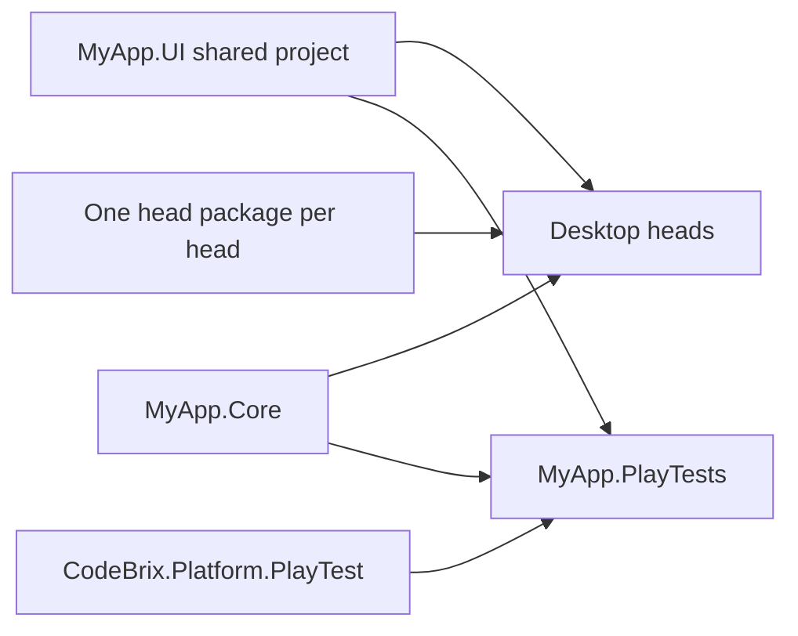

<sub>[CodeBrix](../../../README.md) › [Build a CodeBrix.Platform application](../README.md) › [Testing your application](../10-testing-your-application.md) › PlayTest</sub>

# PlayTest

**PlayTest is a test head for CodeBrix.Platform applications: your test project references it instead of a desktop head, and it runs the application's real XAML, view models and services offscreen, then drives them through a Microsoft Playwright-style locator, action and assertion API.** A test finds an element the way a user would - by its role and name, its test ID or its text - and clicks, types, drags and presses keys with real pointer and keyboard input through the normal input pipeline. Assertions retry until they hold. No browser and no Playwright driver are involved; the API names and call shapes follow Playwright's C# API so that they are familiar.

```csharp
await using var app = await PlayTestApplication.LaunchAsync(() => new App());
var page = app.Page;
await page.GetByRole(AriaRole.Textbox, new() { Name = "Message" }).FillAsync("Hello");
await page.GetByRole(AriaRole.Button, new() { Name = "Send", Exact = true }).ClickAsync();
await Assertions.Expect(page.GetByTestId("status")).ToHaveTextAsync("Sent");
```

PlayTest is the primary way to test the parts a unit test cannot reach: pages, view models running under a real application host, dialogs, menus, pickers, the clipboard and layout in both orientations. [10 - Testing your application](../10-testing-your-application.md) covers the unit tests underneath it.

## What you get

- **A fixed virtual screen.** Exactly 1920 x 1080 logical pixels in landscape or 1080 x 1920 in portrait, at scale 1, rendered by software Skia with the application's embedded fonts and a stable default culture. The pixels are identical on Windows, Linux and macOS, and no display server is needed.
- **Lazy, strict, retrying locators.** Every action waits until its element is visible, enabled, at stable bounds and actually receives the hit test, then injects real pointer or keyboard input.
- **Retrying assertions** that return as soon as the condition holds.
- **Scripted file and folder pickers**, a recording launcher, an isolated clipboard, a simulated operating-system theme, per-test orientation, window close and minimize requests, and held keys.
- **Page and element PNG screenshots**, automatic screenshot recording of a whole run, and an optional live, view-only preview window.
- **Real OpenGL**, for applications built on the Graphics3DGL add-in, through a companion package.

## The two packages

| Package | What it is | Reference it from |
| --- | --- | --- |
| [`CodeBrix.Platform.PlayTest.ApacheLicenseForever`](https://www.nuget.org/packages/CodeBrix.Platform.PlayTest.ApacheLicenseForever) | The test head: the locator, action and assertion API, the virtual screen, the preview and the runner adapters | The `.PlayTests` test project only |
| [`CodeBrix.Platform.PlayTest.OpenGL.ApacheLicenseForever`](https://www.nuget.org/packages/CodeBrix.Platform.PlayTest.OpenGL.ApacheLicenseForever) | Real OpenGL contexts for applications that use the [Graphics3DGL](../add-ins/Graphics3DGL.md) add-in | The `.PlayTests` test project, beside the head package |

Both are Apache 2.0. The namespaces are `CodeBrix.Platform.PlayTest` and `CodeBrix.Platform.PlayTest.OpenGL`. Neither package is ever referenced from an application project or a desktop head project, and a PlayTests project never references a desktop head package. Use the same family version as the application's other CodeBrix.Platform packages; the whole family ships together.

The authoritative API references are the packages' own guides: [AGENT-README.txt for PlayTest](https://github.com/ellisnet/CodeBrix.Platform/blob/main/src/Platform.UI.Runtime.Skia.PlayTest/AGENT-README.txt) and [AGENT-README.txt for PlayTest.OpenGL](https://github.com/ellisnet/CodeBrix.Platform/blob/main/src/Platform.UI.Runtime.Skia.PlayTest.OpenGL/AGENT-README.txt). Each file also ships inside its package.

## How it fits into a solution

A PlayTests project is shaped exactly like a head: it imports the application's `.UI` shared project and references its `.Core` library, so the application's own XAML compiles into it. The PlayTest package then takes the place of the head package.



```text
src/MyApp.Core/                  view models, services, framework and add-in packages
src/MyApp.UI/                    App.xaml(.cs), Views - imported by every head AND by the PlayTests
src/MyApp.LinuxX11/ ...          one project per desktop head
tests/MyApp.PlayTests/           the PlayTest head: xUnit v3 tests over the real UI
tests/libs/MyApp.Something.Tests ordinary unit tests for libraries under src/libs
```

One application runs per test process. The fixture launches it once, every test gets a fresh page (or, for a process-wide engine, a reset of the live page), and tests run one at a time.

## A complete minimal example

The example application is the one built in [03 - Your first application](../03-your-first-application.md), with a page that has a message box, a Send button, a status line and an Open button. The parts of `MainPage.xaml` the tests reach are named for them:

```xml
<TextBox AutomationProperties.Name="Message" Text="{Binding Message, Mode=TwoWay, UpdateSourceTrigger=PropertyChanged}" />
<Button Content="Send" Command="{Binding SendCommand}" />
<TextBlock AutomationProperties.AutomationId="status" Text="{Binding Status}" />
<Button Content="Open…" Command="{Binding OpenCommand}" />
<TextBlock AutomationProperties.AutomationId="FileName" Text="{Binding FileName}" />
```

`AutomationProperties.Name` gives an element its accessible name, which `GetByRole` and `GetByLabel` match; a button's string content is its name already. `AutomationProperties.AutomationId` is the test ID that `GetByTestId` matches.

**1. `global.json`** beside the solution selects the Microsoft Testing Platform runner, which the command-line switches need:

```json
{
    "test": {
        "runner": "Microsoft.Testing.Platform"
    }
}
```

**2. `tests/MyApp.PlayTests/MyApp.PlayTests.csproj`** - an executable test project that compiles the shared `.UI` sources and references `.Core`, exactly like a head:

```xml
<Project Sdk="Microsoft.NET.Sdk">
  <PropertyGroup>
    <TargetFramework>net10.0</TargetFramework>
    <OutputType>Exe</OutputType>
    <RootNamespace>MyApp.PlayTests</RootNamespace>
    <IsPackable>false</IsPackable>
    <UseMicrosoftTestingPlatformRunner>true</UseMicrosoftTestingPlatformRunner>
    <TestingPlatformDotnetTestSupport>true</TestingPlatformDotnetTestSupport>
    <!-- Match the application's own settings: its shared .UI sources compile into this project. -->
    <Nullable>disable</Nullable>
    <ImplicitUsings>disable</ImplicitUsings>
    <!-- Optional project preferences; the command line and the environment override them. -->
    <CodeBrixPlayTestPreferredOrientation>Landscape</CodeBrixPlayTestPreferredOrientation>
    <CodeBrixPlayTestPreferredTheme>Light</CodeBrixPlayTestPreferredTheme>
  </PropertyGroup>

  <!-- The application's App.xaml and Views, as in every head -->
  <Import Project="../../src/MyApp.UI/MyApp.UI.projitems" Label="Shared" />

  <ItemGroup>
    <ProjectReference Include="../../src/MyApp.Core/MyApp.Core.csproj" />
  </ItemGroup>

  <ItemGroup>
    <PackageReference Include="CodeBrix.Platform.PlayTest.ApacheLicenseForever" />
    <PackageReference Include="Microsoft.NET.Test.Sdk" />
    <PackageReference Include="xunit.v3" />
    <PackageReference Include="xunit.runner.visualstudio" PrivateAssets="all" />
    <PackageReference Include="SilverAssertions.ApacheLicenseForever" />
  </ItemGroup>
</Project>
```

There is no head package, no `<Page>` glob and no `DefineConstants` line: the PlayTest package's build logic makes the project a head and defines `HAS_CODEBRIX`, `HAS_CODEBRIX_WINUI`, `HAS_CODEBRIX_SKIA` and `HAS_CODEBRIX_PLAYTEST` itself.

**3. `tests/MyApp.PlayTests/AppFixture.cs`** - launches the application once for the whole run, and resets the page before each test:

```csharp
using System.Threading.Tasks;
using CodeBrix.Platform.PlayTest;
using MyApp.Views;
using Xunit;

[assembly: Xunit.v3.Parallelization(Mode = Xunit.Sdk.ParallelMode.None)]

namespace MyApp.PlayTests;

public sealed class AppFixture : IAsyncLifetime
{
    public PlayTestApplication Application { get; private set; }

    public async ValueTask InitializeAsync() =>
        Application = await PlayTestApplication.LaunchAsync(() => new App(), new()
        {
            ConfigurationAssembly = typeof(AppFixture).Assembly,
        });

    public Task ResetAsync(ScreenOrientation? orientation = null)
    {
        Application.FilePickers.Clear();
        Application.Launcher.Clear();
        return Application.Page.SetContentAsync(() => new MainPage(), orientation);
    }

    public async ValueTask DisposeAsync()
    {
        if (Application != null) await Application.DisposeAsync();
    }
}

[CollectionDefinition("App")]
public sealed class AppCollection : ICollectionFixture<AppFixture> { }
```

**4. `tests/MyApp.PlayTests/MainPageTests.cs`** - four representative tests:

```csharp
using System.IO;
using System.Threading.Tasks;
using CodeBrix.Platform.PlayTest;
using SilverAssertions;
using Xunit;

namespace MyApp.PlayTests;

[Collection("App")]
public sealed class MainPageTests(AppFixture fixture) : PageTest(fixture.Application), IAsyncLifetime
{
    public async ValueTask InitializeAsync()
    {
        // Apply a [PlayTestOrientation] requirement, if the test declares one, before the page is built.
        var test = (Xunit.v3.IXunitTest)TestContext.Current.Test;
        test.Traits.TryGetValue(PlayTestOrientationAttribute.CaseTraitName, out var rows);
        await fixture.ResetAsync(PlayTestOrientationAttribute.Resolve(test.TestMethod.Method, rows));
    }

    public ValueTask DisposeAsync() => ValueTask.CompletedTask;

    private Locator Button(string name) => Page.GetByRole(AriaRole.Button, new() { Name = name, Exact = true });

    [Fact]
    public async Task Send_is_disabled_until_a_message_is_typed()
    {
        await Expect(Button("Send")).ToBeDisabledAsync();
        await Page.GetByRole(AriaRole.Textbox, new() { Name = "Message" }).FillAsync("Hello");
        await Expect(Button("Send")).ToBeEnabledAsync();
    }

    [Fact]
    public async Task Sending_shows_the_status()
    {
        await Page.GetByRole(AriaRole.Textbox, new() { Name = "Message" }).FillAsync("Hello");
        await Button("Send").ClickAsync();
        await Expect(Page.GetByTestId("status")).ToHaveTextAsync("Sent");
    }

    [Fact]
    public async Task Opening_a_file_shows_its_name()
    {
        var path = Path.Combine(Path.GetTempPath(), "input.txt");
        await File.WriteAllTextAsync(path, "content", TestContext.Current.CancellationToken);
        fixture.Application.FilePickers.EnqueueOpenFile(path);   // queued BEFORE the click
        await Button("Open…").ClickAsync();
        await Expect(Page.GetByTestId("FileName")).ToHaveTextAsync("input.txt");
        fixture.Application.FilePickers.OpenFileRequestCount.Should().Be(1);
    }

    [Fact]
    [PlayTestOrientation(ScreenOrientation.Portrait)]
    public async Task Portrait_layout_keeps_the_status_on_screen()
    {
        await Expect(Page.GetByTestId("status")).ToBeVisibleAsync();
        var box = await Page.GetByTestId("status").BoundingBoxAsync();
        (box.X + box.Width).Should().BeLessThanOrEqualTo(fixture.Application.Width);
    }
}
```

**5. Run it** from the application root:

```bash
dotnet test --project tests/MyApp.PlayTests/MyApp.PlayTests.csproj
dotnet test --project tests/MyApp.PlayTests/MyApp.PlayTests.csproj --headed --theme=dark
```

The first run is headless. The second opens a live preview window and simulates a dark operating-system theme. [Running, switches and the preview](running-and-switches.md) has every switch.

## The pages

| Page | What it covers |
| --- | --- |
| [Getting started](getting-started.md) | The project file, `global.json`, the fixture, the per-test reset, `PageTest`, orientation requirements and the first run, explained line by line |
| [Locators and actions](locators-and-actions.md) | `GetByRole`, `GetByTestId`, `GetByText`, `GetByLabel`, `GetByType<T>`, scoping and filtering, strict mode, clicks, fills, keys, held keys, the mouse, drags, checked controls, `SelectOptionAsync` and scrolling |
| [Assertions and reading state](assertions.md) | `Expect(...)` and every retrying assertion, `EvaluateAsync`, `WaitForAsync`, one-shot reads, timeouts and what a failure reports |
| [Pickers, clipboard, theme and orientation](pickers-clipboard-theme-orientation.md) | Scripted file and folder pickers, the recording launcher, the isolated clipboard, the simulated theme, orientation per test, and window close and minimize |
| [Screenshots and recording](screenshots-and-recording.md) | Page and element screenshots, stable captures, measuring pixels, and recording every step of a run with `--screenshotfolder` |
| [Running, switches and the preview](running-and-switches.md) | `--headed`, `--headless`, `--theme`, `--orientation`, `--screenshotfolder`, the environment variables, project preferences, precedence, the preview window and action delay |
| [Patterns from the samples](patterns-from-the-samples.md) | Replacing services at the DI boundary, a shared fixture base class, the launch-once pattern for process-wide engines, throwaway settings stores, games and canvases, and the sample suites to read |
| [OpenGL](opengl.md) | The companion package for Graphics3DGL applications: registering the provider, per-OS requirements, opting out, and asserting GL content with `PixelStats` |

## What PlayTest does not do

- No browser, DOM, CSS or JavaScript, network routing, tracing or download API - it tests CodeBrix.Platform XAML applications.
- One window and one application per process.
- No OpenGL without the OpenGL companion package; no Metal or Vulkan surfaces; no native dialogs other than the scripted storage pickers; no horizontal mouse wheel.
- No physical input: the preview window is view-only.
- No pixel-diff or visual-regression comparison against saved images. Screenshots are produced for people to look at, and `PixelStats` measures captures taken in the running test.
- No real window close, minimize or process exit: those requests raise the window events and the application keeps running.
- No automatic key repeat while a key is held.
- No Android: PlayTest drives the desktop build of the application, not a CodeBrix.Android head - see [Testing an Android head](../15-android.md#testing-an-android-head).

---

**Where to go next**

- [Getting started](getting-started.md) - the first page of this set
- [10 - Testing your application](../10-testing-your-application.md) - unit tests, fixtures and doubles underneath the UI tests
- [PlayTestDemo](https://github.com/ellisnet/CodeBrix.Platform/tree/main/samples/CodeBrixPlatform/PlayTestDemo) - a demo application whose PlayTests exercise every part of the API
- [CodeBrix.Samples PlayTest suites](https://github.com/ellisnet/CodeBrix.Samples/blob/main/PlayTestSupport/README.md) - one PlayTests project per sample application
